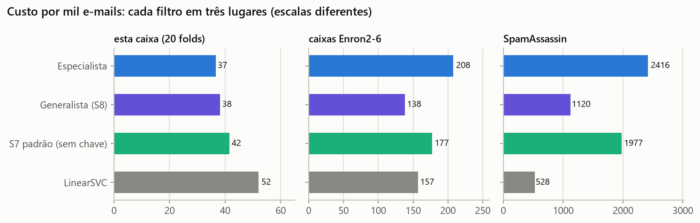

# Filtro de spam com stacking: o que um classificador aprende de uma caixa de e-mail

Projeto 3 de **Data Science 2 (ESEG)**, com o Prof. Marino Catarino.
**Autores:** Phelipe Torres Pamponet da França (RA 46643) e Felipe Marins.

São 5172 e-mails (3672 e-mails reais e 1500 spams), cada um descrito pela contagem de 3000 palavras. O ponto de partida foi um classificador. A investigação foi além: de onde vêm os dados, quais modelos erram de formas diferentes, quanto do ajuste fino é ilusão e o que acontece quando o filtro encontra uma caixa de e-mail que nunca viu.

| | |
|---|---|
| 📓 Notebook para o professor | [`Projeto3_Classificacao_Spam.ipynb`](Projeto3_Classificacao_Spam.ipynb): a história completa, com o código principal visível, em poucos minutos |
| 🎞️ Apresentações | [banca](https://felipe44776-eseg.github.io/filtro-spam-stacking-enron/apresentacao/banca/) (técnica) · [equipe](https://felipe44776-eseg.github.io/filtro-spam-stacking-enron/apresentacao/equipe/) (didática, com glossário) |
| ✉️ Demonstração | `streamlit run demo/app.py`: cole um e-mail e veja cada etapa até a decisão |
| ✅ Para a banca | [INSTALACAO.md](INSTALACAO.md) · [COMO_TESTAR.md](COMO_TESTAR.md) |
| 🧭 Decisões e números | [docs/REGISTRO_DECISOES.md](docs/REGISTRO_DECISOES.md) · [docs/METODOLOGIA.md](docs/METODOLOGIA.md) · [docs/MODEL_CARD.md](docs/MODEL_CARD.md) |

## Os filtros

Todos usam o **limiar de custo**: perder 1 e-mail real custa o mesmo que receber 9 spams. O custo é por mil e-mails; quanto menor, melhor.

| Filtro | O que é | MCC (20 folds) | Custo (20 folds) | Teste trancado: reais na lixeira / spams que passaram | Custo Enron2-6 | Custo SpamAssassin |
|---|---|---|---|---|---|---|
| **Especialista** (esta caixa) | Stacking 7 afinado pelo algoritmo genético | 0,974 | 36,6 | 1 / 10 | 207,6 | 2416,5 |
| **Generalista** (caixas novas) | Stacking 7 padrão + TabPFN-3.5 (Stacking 8) | 0,973 | 38,2 | 2 / 13 | 138,5 | 1119,9 |
| Stacking 7 padrão (caixas novas, sem chave) | Stacking 7 padrão (roda offline; usado na demo) | 0,973 | 41,5 | 0 / 17 | 177,5 | 1977,2 |
| LinearSVC (linha de base) | LinearSVC com TF-IDF log | 0,960 | 52,0 | 3 / 23 | 156,9 | 528,4 |

As colunas "20 folds" e "teste trancado" medem a mesma caixa de e-mail do treino. "Enron2-6" são caixas de outras 5 pessoas, e "SpamAssassin" é outra empresa e outra época. Nenhuma das duas foi usada no treino.



## O que descobrimos

1. **O CSV é o Enron1, e as palavras foram contadas como substring.** Reproduzimos 5172 de 5172 linhas a partir dos textos originais. Há 26 colunas de uma letra só, e "ect" aparece em todos os e-mails, porque está dentro de "subject".
2. **Duplicata não indica spam.** 93% das 541 cópias são e-mails reais. Cópias idênticas ficam sempre do mesmo lado da divisão treino/teste.
3. **Sem rótulo, os grupos naturais são assuntos, não "spam × real".** O K-means tem ARI de -0,07. A melhor pista sem rótulo é "não se parece com meus e-mails reais", o erro de reconstrução, com PR-AUC 0,80.
4. **A representação vale mais que o algoritmo.** Com TF-IDF com log, a Reg. Logística sobe de 0,923 para 0,961, e o kNN, de 0,746 para 0,940.
5. **Diversidade vence quantidade.** O Stacking 7 tem um modelo por família. O kNN, fraco sozinho, recebe o maior peso do meta-modelo (1,67), e 13 modelos não superam 7.
6. **O ajuste fino engana.** O algoritmo genético explorou 7.077.888 combinações. Em divisões novas, 85% do ganho medido na busca desapareceu (a maldição do vencedor).
7. **O filtro aprende a caixa, não o spam.** Numa base nunca usada (SpamAssassin), todos os filtros caem, embora o mesmo pipeline treinado *dentro* dela chegue a MCC 0,968. A regra registrada antes do teste promoveu o **Stacking 8 (com o TabPFN)** a Generalista: ele custou 857 a menos por mil, com P(redução) = 1,00. Para uso real, o caminho é retreinar com e-mails da caixa de destino.
8. **O protocolo não vaza.** Com os rótulos embaralhados, o MCC vai de 0,961 para 0,000 (p = 0,032).

## Como rodar em 3 comandos

```powershell
pip install -r requirements.txt; pip install -e . --no-deps   # Python 3.11
pytest                                                       # 31 testes rápidos, menos de 1 min
jupyter notebook Projeto3_Classificacao_Spam.ipynb           # ou: streamlit run demo/app.py
```
Passo a passo para Windows, macOS/Linux e Colab: [INSTALACAO.md](INSTALACAO.md). Os filtros treinados estão em *Releases*, ou podem ser refeitos com `python scripts/09_modelos_finais.py`.

## Estrutura

```text
├── Projeto3_Classificacao_Spam.ipynb   notebook-história (para o professor)
├── notebooks/        01 a 09: um notebook técnico por etapa, gerado dos scripts e executado
├── scripts/          a fonte dos notebooks (formato # %%) e os geradores (notebooks, documentos)
├── spamfilter/       o pacote: dados, conversão, modelos, métricas, estatística, motor com cache, genético, filtro final
├── tests/            pytest (rápidos) e pytest -m lento (regressão completa contra o registro)
├── resultados/       metricas_finais.json (fonte única dos números), figuras, CSVs, caches
├── apresentacao/     decks HTML (banca e equipe), gerados por build.py a partir dos resultados
├── demo/             app "cole um e-mail" (Streamlit)
├── dados/            CSV do enunciado, Enron1-6 da AUEB e contagens do SpamAssassin (ver dados/LEIA-ME.md)
├── experimentos/     os experimentos originais 01 a 05, com caches e notebooks, como foram executados
└── docs/             registro de decisões, metodologia, ficha do modelo, contrato dos resultados
```

## Dados, licenças e citação

- **CSV:** Kaggle, *Email Spam Classification Dataset CSV* (`balaka18`). A licença não pôde ser verificada (a página exige login); o uso é acadêmico.
- **Enron-Spam:** V. Metsis, I. Androutsopoulos e G. Paliouras, "Spam Filtering with Naive Bayes – Which Naive Bayes?", CEAS 2006. Fonte: http://www2.aueb.gr/users/ion/data/enron-spam/
- **SpamAssassin public corpus:** https://spamassassin.apache.org/old/publiccorpus/. O copyright do texto é dos remetentes, por isso o repositório guarda só as contagens. Para baixar: `spamfilter.externo.baixar_spamassassin()`.
- **TabPFN-3.5** (Prior Labs): licença não comercial, que permite pesquisa e avaliação. A chave fica só na variável `TABPFN_TOKEN`.
- **Código:** licença MIT ([LICENSE](LICENSE)).

*Gerado por `scripts/gerar_documentos.py` a partir de `resultados/metricas_finais.json` (2026-10-28).*
